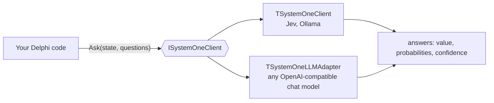

# System One for Delphi

### A Delphi client for System One models: ask typed questions, get answers with probabilities

[](CHANGELOG.md)
[](LICENSE)
[](https://www.embarcadero.com/products/delphi)
[](#install)

A **System One model** does not write text, it *decides*. You give it a piece of text (the *state*) and a few typed *questions*; it answers each one with a value, the probability of every option and a confidence, in tens or hundreds of milliseconds and with nothing to parse. This library is a small Delphi client for them: one unit, RTL only.

## 📖 Full documentation → **[www.danieleteti.it/systemone-delphi](https://www.danieleteti.it/systemone-delphi/)**

This README is just a hook. For what System One models are and how the API works, read the TypeSafe article [Introducing System One models and Jev](https://typesafe.ai/blog/introducing-system-one-models-and-jev).

---

## What is this good for?

A backend receives free text all day: tickets, e-mails, notes, chat messages. Most of what you do with it is a *decision*, not a piece of writing:

- route a request to the right team,
- tell a complaint from a question, or a question from an attack,
- decide whether a message needs a big (slow, costly) LLM at all,
- gate an action: "is the user asking me to send something to someone?"

A chat LLM can do it, but it is slow, it costs a call and it answers in prose. A System One model answers with a number you can compare to a threshold.



## Features

- **One interface, two implementations.** `ISystemOneClient.Ask` is answered by `TSystemOneClient` (the System One API: TypeSafe Jev, and Ollama) or by `TSystemOneLLMAdapter` (the same questions put to any OpenAI-compatible chat model). Code against the interface, swap the engine.
- **Three question types.** `Choice` (one label among several), `Score` (a level on an ordered scale), `Noul` (a yes/no as a number from 0 to 1).
- **Typed, ready-to-use answers.** Label, expected level, probability of every option, confidence, token usage. No text to parse.
- **Local or cloud.** Point `TSystemOneClient` at Ollama on your machine (no key, no data leaves it) or at the Jev API (with a key).
- **No dependencies.** A single unit, `System.JSON` and `System.Net.HttpClient` from the RTL. Nothing to install.
- **Tested.** An offline suite (36 checks) against a fake server, and a live suite (15 checks) against real models on Ollama, `TSystemOneLLMAdapter` included.

## Install

Copy `sources\SystemOne.Client.pas` into your project, or add the `sources` folder to your search path. That is all.

## Quickstart

For a local model, install [Ollama](https://ollama.com) (0.35.1 or later) and run `ollama pull tev1:4b`.

```pascal
uses
  SystemOne.Client;

var
  Client: ISystemOneClient;
  Response: TSOResponse;
begin
  Client := TSystemOneClient.Create('http://localhost:11434', '', 'tev1:4b');   // server, key, model
  // for Jev: TSystemOneClient.Create('https://api.typesafe.ai', GetEnvironmentVariable('TYPESAFE_API_KEY'), 'jev-latest')

  Response := Client.Ask('The August invoice is wrong: you charged me twice. Refund me, it is urgent.', [
    TSO.Choice('team', 'Which team should handle this request')
      .Option('billing', 'Payments, charges, refunds')
      .Option('technical', 'Faults and service problems')
      .Option('other', 'Anything else'),
    TSO.Noul('urgent', 'The message conveys urgency')]);
  try
    if (Response.Answers['team'].Choice = 'billing') and (Response.Answers['team'].Confidence > 0.8) then
      WriteLn('send to billing');             // confident: act on it
    WriteLn(Response.Answers['urgent'].Noul:0:2); // 0..1
  finally
    Response.Free;                            // you own the response
  end;
end;
```

A complete, runnable version is in [`sample\Triage.dpr`](sample/Triage.dpr). [`sample\UseCases.dpr`](sample/UseCases.dpr) runs three more uses on a few messages: ranking emails by priority, classifying incoming documents and gating an assistant.

The three question builders:

| Builder | Answer | Fields you read |
|---|---|---|
| `TSO.Choice(id, instructions).Option(label, description)...` | one label | `Choice`, `Confidence`, `Probabilities` |
| `TSO.Score(id, instructions, ['level 0', 'level 1', ...])` | a level on an ordered scale | `Score` (a fraction: 1.24 means between levels 1 and 2), `Confidence`, `Probabilities` |
| `TSO.Noul(id, instructions)` | yes/no as a number | `Noul` (0 to 1) |

## Engines

| Class | Talks to | Notes |
|---|---|---|
| `TSystemOneClient` | `POST /v1/systemone` of the TypeSafe API, or of Ollama (`http://localhost:11434`), or of any server with the same API | `Create(server, key, model)`: no server is assumed, you always say where the model is. Jev needs a key; pass `''` for a local server and no `Authorization` header is sent |
| `TSystemOneLLMAdapter` | `/chat/completions` of OpenAI, OpenRouter, Ollama, vLLM... | Asks for a strict JSON Schema, normalizes the probabilities it gets back. The probabilities are the ones the chat model reports, so choose thresholds on your own data. Use it to build and test the flow before you have a System One model (the calling code stays the same when you switch), or when you have none|

## Status and honest limits

- **Tested against:** Ollama 0.40.6 with `tev1:4b` on an RTX 4060 laptop GPU (8 GB): the first call after the model is unloaded takes seconds (loading), then about 90 ms per call. `TSystemOneLLMAdapter` is tested against an Ollama chat model (`minicpm-v4.6:1b`).
- **Not yet tested:** the real Jev API (the client follows the documented request and response shapes and is tested against a fake server), OpenRouter, Ollaya and the Ollama models other than `tev1:4b` (`tev1:0.8b`, `nimble`, `clef`).
- **Not supported:** images and the `box` question type (find an object in an image). Jev announced both in 1.14 as an opt-in experimental feature; the open models on Ollama that I checked (`tev1`, `nimble`) are text only.
- **Short texts for `tev1`:** its Ollama page says it runs with a context of about 2,000 tokens. Send it a ticket, not a document.
- **Compilers:** built and tested with Delphi 12 and 13, Win32. Other platforms and versions are untested.
- **A 4 B model is not an oracle.** Use the confidence: act when it is high, ask or fall back to a bigger model when it is not. Do not use a classifier as the only guard in front of an action with consequences.

## Tests

```bat
python tests\run_all.py              rem builds and runs the offline suite
python tests\run_all.py --live       rem plus the live suite against Ollama + tev1:4b
python tests\run_all.py --live --chat-model minicpm-v4.6:1b   rem and TSystemOneLLMAdapter on that chat model
python tests\run_all.py --bds "C:\Program Files (x86)\Embarcadero\Studio\23.0"
```

The offline suite starts `tests\fake_server.py` (a stand-in for the TypeSafe and the chat APIs), runs, and stops it. It proves the client: request shape, parsing, ranges, errors. It says nothing about how a real model answers; the live suite does that on a few cases.

## Versioning

[Semantic Versioning](https://semver.org): `MAJOR.MINOR.PATCH`.

- While the version is `0.x`, the API may still change: a **minor** release may break, a **patch** release never does.
- `1.0.0` comes when the client has been used against the real Jev API and the interface has settled.
- The version lives in one constant, `SYSTEMONE_CLIENT_VERSION` in the unit, and is kept in step with the badge above and with [CHANGELOG.md](CHANGELOG.md). A release is a git tag `vMAJOR.MINOR.PATCH`.

## License

[Apache 2.0](LICENSE), free for commercial and personal use.

Made by [Daniele Teti](https://www.danieleteti.it), author of [DelphiMVCFramework](https://github.com/danieleteti/delphimvcframework). It pairs well with [MCP for Delphi](https://github.com/danieleteti/mcp-server-delphi): an agent for what needs words, a System One model for what needs a decision.
